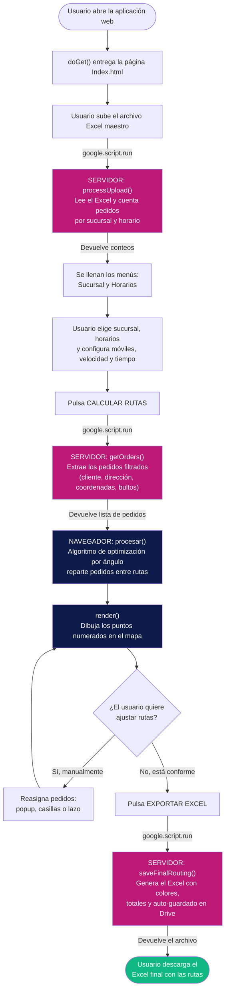
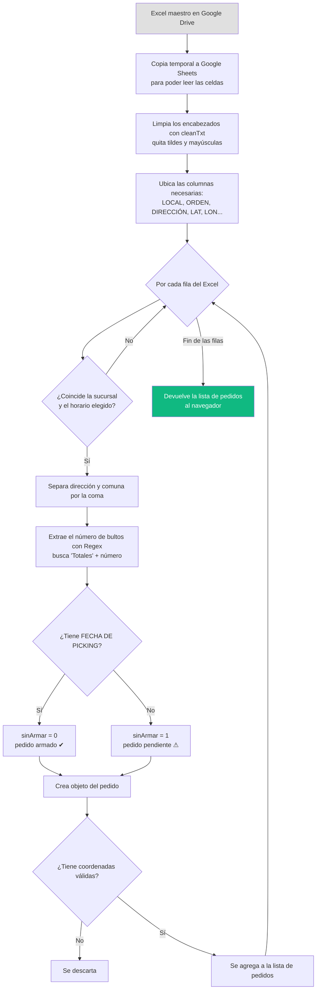
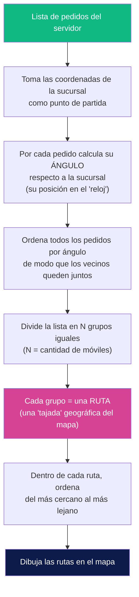
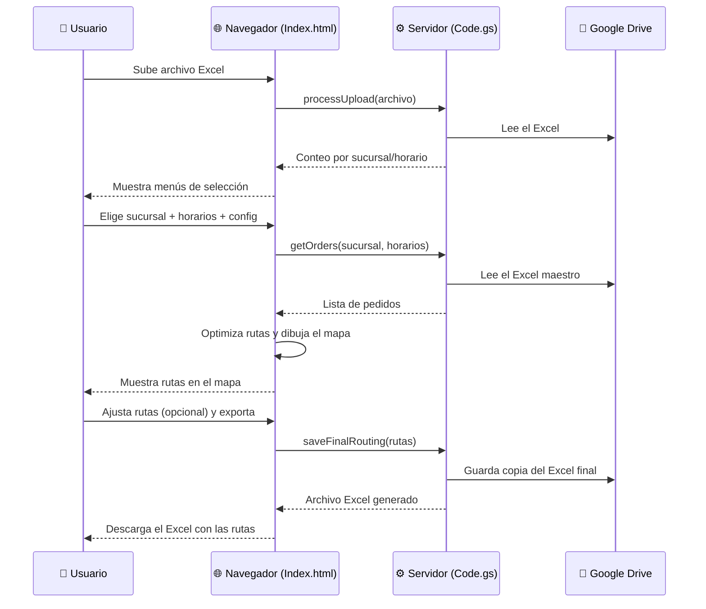

# Diagrama de Flujo — Smart Router (Sistema de Ruteo VS)

Este documento explica **cómo viajan los datos** dentro del sistema: desde que el
usuario sube el archivo Excel hasta que descarga las rutas optimizadas.

El sistema tiene **dos partes** que conversan entre sí:

| Parte | Archivo | Dónde corre | Rol |
|-------|---------|-------------|-----|
| **Front-end** (interfaz) | `Index.html` | En el **navegador** del usuario | Muestra el mapa, los controles y dibuja las rutas |
| **Back-end** (servidor) | `Code.gs` | En los **servidores de Google** | Lee el Excel, procesa datos y genera el archivo final |

La comunicación entre ambos se hace con `google.script.run`, que es el "puente"
que permite al navegador pedirle tareas pesadas al servidor.

---

## 1. Flujo general del sistema (visión completa)

> 🟣 **Morado** = funciones del SERVIDOR (`Code.gs`)
> 🔵 **Azul** = funciones del NAVEGADOR (`Index.html`)
> 🟢 **Verde** = resultado final entregado al usuario

---

## 2. Detalle: ¿qué hace el servidor con el Excel? (`getOrders`)

Este es el paso clave donde los datos crudos del Excel se transforman en
pedidos listos para mapear.

---

## 3. Detalle: el algoritmo de optimización (`procesar`)

El corazón del sistema. En vez de asignar rutas al azar, agrupa los pedidos
**geográficamente** para que cada móvil cubra una zona y los camiones no se crucen.

**Analogía sencilla para la presentación:** imagina la sucursal en el centro de
una pizza. El algoritmo corta la pizza en porciones (una por cada móvil), y cada
porción es una ruta. Así cada camión atiende su zona sin pisar la del otro.

---

## 4. Resumen de la "conversación" navegador ↔ servidor

---

## Glosario rápido (por si lo preguntan en la defensa)

- **Front-end / Back-end:** la cara visible (lo que el usuario ve) vs. el motor
  oculto que hace los cálculos.
- **`google.script.run`:** el mecanismo que conecta el navegador con el servidor.
- **Regex (expresión regular):** una "fórmula de búsqueda" para encontrar texto
  con un patrón (aquí se usa para extraer el número de bultos).
- **Latitud / Longitud:** las coordenadas que ubican cada dirección en el mapa.
- **Fórmula de Haversine:** cálculo de distancia entre dos puntos del planeta
  considerando la curvatura de la Tierra.
- **Blob:** un bloque de datos binarios (la forma en que viaja un archivo).
- **Base64:** una forma de convertir un archivo a texto para poder enviarlo.
